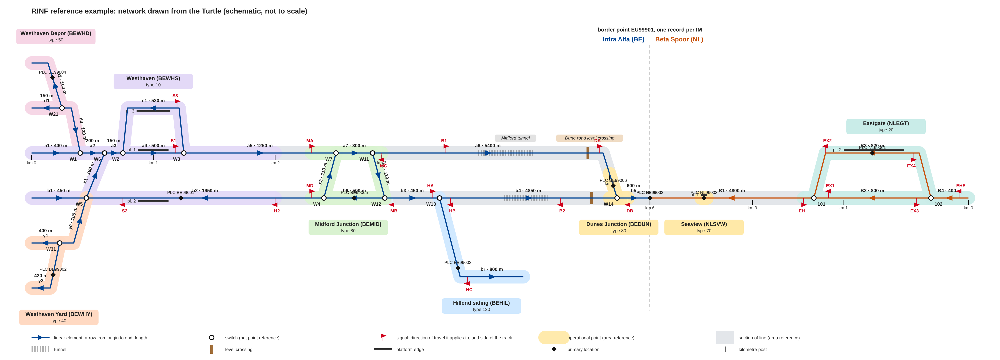

# RINF by example

A fictive RINF dataset on ERA ontology **v3.3.4**, with a page that explains it: the network drawn from the
Turtle, next to the Turtle itself, one scene per screen.

**Page:** https://matdata-eu.github.io/era-rinf-example/

Two infrastructure managers in two countries: Infra Alfa (Belgium) and Beta Spoor (Netherlands). Everything
except the country IRIs is invented, and the geometries are schematic and lie in the North Sea.

## The data

| File | Content |
|---|---|
| `data/im-a-belgium.ttl` | Infra Alfa: Westhaven station, depot and yard, Midford Junction, Hillend siding, Dunes Junction, border |
| `data/im-b-netherlands.ttl` | Beta Spoor: border, Seaview stopping point, Eastgate |
| `data/era-managed.ttl` | Stand-in for the reference border point that ERA manages |

3,222 triples: 28 linear elements, 48 net relations, 15 switches (one double slip crossing), 21 signals,
9 operational points in 10 records (the border point is delivered by both managers), 9 sections of line (two of
nature Link inside the Westhaven station area, each a point reference on the switch), 28 tracks and sidings,
5 platform edges, 1 tunnel, 1 level crossing, 10 primary locations (one per operational point record, with the
same net reference) and 3 subsidiary locations, 9 kilometre posts on 2 lines.

The Turtle is written by `tools/build_network.py` from one compact network definition, so offsets, relation
flags and geometries stay consistent. Change the generator and run it again (`python3 tools/build_network.py data`)
rather than editing the Turtle by hand.

## Checks

    pip install rdflib pyshacl
    python3 tools/validate.py data <clone of era-ontology at v3.3.4>   # SHACL: 0 violations, 74 warnings
    python3 tools/check_topology.py data                               # 15 consistency checks
    python3 tools/draw.py data docs/network.svg                        # the drawing above

The 74 warnings are unfilled ETCS parameters; the example is not fully populated on purpose.
`tools/validate.py` works around non-standard SPARQL in the v3.3.4 shapes. Results of the last run are in `docs/`.

## The page

    npm install
    npm run dev            # local development
    npm run build          # static site in dist/, deployed to GitHub Pages on every push to main
    npm run build:single   # one self-contained dist-single/index.html

| Path | Role |
|---|---|
| `src/lib/rdf.js` | N3.js stores over the example and the bundled vocabulary, prefixes, lookups |
| `src/lib/net.js` | Geometry from the Turtle: element shapes from the WKT, positions from element + offset, `locate(iri)` |
| `src/lib/turtle.js` | Turtle writer that returns tokens, so every IRI is a link |
| `src/components/NetworkDrawing.vue` | The SVG drawing; every object is clickable |
| `src/components/TurtleBox.vue` | The Turtle box: click = open, Ctrl + click = add |
| `src/scenes.js` | The scenes as plain data (title, text, box, focus, layers) |
| `src/vocab/vocab.ttl` | The v3.3.4 ontology and the code list values the example uses (`tools/build_vocab.py`) |

Nothing about the network is written in the page code. Change the Turtle and the drawing follows.

## Modelling choices

1. Data IRIs are under `http://data.europa.eu/949/example/`. The managers use the fictive organisation codes
   9901 and 9902 inside the ERA organisation namespace, because the SHACL requires that IRI pattern.
2. Every stretch of track belongs to an operational point or to a section of line, and there is an operational
   point wherever the number of tracks of a section of line changes. The one exception is the stopping point
   Seaview: it has no tracks, and its area lies on top of the line track (see 9).
3. Directions and sides are given in four frames, each as its ontology definition says:
   - `era:appliesToDirection` on a net point reference: relative to the linear element (origin to end);
   - `era:direction` of an `era:Orientation`: relative to its `era:carrierLinearElement`;
   - `era:signalOrientation` of a signal: relative to the line (rising kilometrage);
   - `era:trackDirection` of a section-of-line track: relative to the section of line (`era:opStart` to `era:opEnd`).

   `era:side` is given relative to the carrier linear element, as the other half of the `era:Orientation` it sits
   on. Note that the v3.3.4 definition of `era:side` itself speaks of "the running direction from the origin of
   the referencing system (e.g. direction of the main line)", which is the frame of `era:signalOrientation`.
   On an element that runs against the line the two readings give opposite sides.
4. The two networks are not joined by a net relation. They share the border point: each manager delivers an
   operational point of type border point with the same UOPID, reference border point and coordinates.
5. Signals are main signals for the normal running directions (Infra Alfa: track 1 eastbound, track 2 westbound,
   signals on the left; Beta Spoor: signals on the right), plus both directions on the stretch W12 - W13 that
   trains to and from the Hillend siding use, and a westbound protection signal on track 1 east of W11 for
   Midford Junction (the track between Midford and Dunes is therefore direction B) and an eastbound protection
   signal on track 2 for W4 (the track between Westhaven and Midford is therefore direction B as well). Shunting
   signals and wrong-road signalling are left out. The stopping point Seaview has no signals.
6. Switches have a net point reference only, on the common branch where the elements meet (the double slip W5 on
   element `b1`). Its `era:appliesToDirection` points towards the branches, as `applicationDirection` in railML:
   Normal at the end of the common branch, Opposite at its origin. `era:connectedTo` and navigability `AB` / `BA`
   are not used.
7. Contact line system, ETCS and train detection are not infrastructure elements in v3.3.4, so an "area" is the
   set of tracks that point to the same subsystem node.
8. Geometry nodes are IRIs and each feature has one geometry, as the SHACL requires.
9. A platform does not cut a track. The stopping point Seaview (type passenger stop) has no tracks: its area
   reference includes the linear reference of its platform edge, so the operational point covers exactly the
   platform. One track, Eastgate - border, runs on under the platform and is part of both sections of line,
   Eastgate - Seaview and Seaview - border. Each of those sections gives its own extent in a linear reference of
   its own.
10. Every `era:hasPart` has its reverse `era:isPartOf` on the part. v3.3.4 declares no inverse between the two,
    so the data states both.
11. Every operational point record has a primary location, and the primary location uses the operational
    point's own net reference node.

## Questions and answers

From the discussion on [ERA ontology work item #65](https://gitlab.com/era-europa-eu/public/interoperable-data-programme/era-ontology/era-ontology/-/work_items/65),
which started from the old `examples/switch.ttl`. This example is meant to replace that file.

**Is navigability physical or operational?**
Physical: a net relation says whether a train can pass from the end of one netelement to the end of the other,
whatever the operating rules. It applies to every track, main track or siding.

**Is there a real case of navigability in one direction only?**
The example leaves `AB` / `BA` out on purpose: every net relation is `Both` or `None`.

**Does a switch have its own micro topology? Should it be a NonLinearElement?**
No. In the example a switch is an `era:Switch` with one `era:NetPointReference`, and the netrelations at that
point describe how it connects. There is no NonLinearElement. RINF does not specify this exactly, and a switch
could also be given an area reference, but for the RINF use cases a point reference is good enough.

**Why is the switch not at the end of the first linear element, where the three elements meet?**
The ends of the three elements that meet at a switch are the same topological location, so the reference can
be given on any of them. The example always uses the common branch.

**Why is the switch related to one linear element only?**
Through its reference it sits on one element; the three netrelations at that point relate all three. Nothing
else is needed.

**A linear element runs through an operational point and a section of line. Is that intentional?**
Yes. A netelement runs between two places where the topology changes: a switch or crossing, a buffer stop or
the end of a track, the end of the manager's network at a border, or moving track such as a turntable. An
operational point boundary is not such a place, so the netelement continues and the tracks of the operational
point and the section of line each cover their own stretch of it (`a6` carries Midford - Dunes track 1 from
200 to 5200 m and Dunes Junction track 1 from 5200 to 5400 m). Cutting netelements at operational point
boundaries is allowed, but then every cut needs a net relation (navigability `Both`) or the network falls apart.

**Should there be a net relation between the netelement of the operational point and that of the section of line?**
Not here: it is one netelement, and navigability along a netelement is implicit. Net relations only connect the
ends of two different netelements.

**Why does a switch's net point reference carry `era:appliesToDirection`?**
It points towards the branches (see modelling choice 6), so the reference alone tells on which side of the
switch the branches are. The property is optional in the v3.3.4 shapes and its definition says nothing about
switches.

**Do netelements that only connect two tracks, as in a crossover, have to be tracks?**
In the example they are (Midford crossovers `X1` and `X2`), because every netelement belongs to an operational
point or a section of line through its tracks. The ontology does not require it. Without a track the topology
and navigability stay complete, but the piece has no track parameters. `era:trackId` is mandatory on a track in
v3.3.4, so a crossover track needs an identifier, generated if necessary.

**How to model two consecutive switches?**
Two switches in the field are two `era:Switch` objects, each with its own point reference, and a netelement
between them, however short, with three net relations at each switch. A single three-way switch, where all
blades start at the same point, can be one `era:Switch`: four netelement ends meet in one point, as at the
double slip W5, with `Both` from the common branch to each branch and `None` between the branches.

**Where does an operational point start and end?**
RINF and the ontology have no harmonised rule; each infrastructure manager decides. In the example the boundary
of Dunes Junction lies 200 m before switch W14, which puts signal DA outside it; that is not a deliberate rule.
A convention that is easy to explain: at the entry signals where there are any, otherwise at the ends of the
platform or at the outermost switch. The stopping point Seaview shows the case without signals: its area is its
platform edge.

**Why are tunnels linked to tracks only through the topology?**
The topology is the precise link: it says which stretch of which netelement lies in the tunnel. To find the
tracks through a tunnel, look for track references that overlap the tunnel's reference on the same netelement.
v3.3.4 deprecates `era:passesThroughTunnel` (track to tunnel) and names `era:hasPart` as its replacement, so a
direct link, if wanted, is `track era:hasPart tunnel`. The example does not state it.
