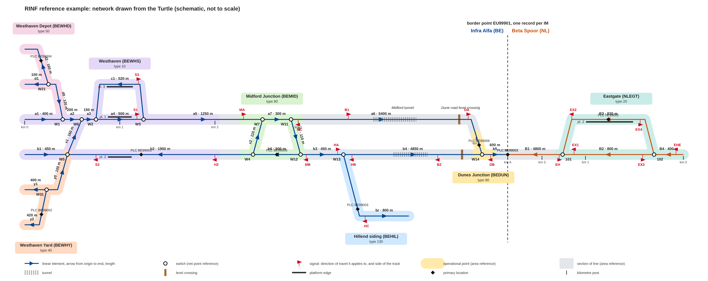

# RINF by example

A fictive RINF dataset on ERA ontology **v3.3.4**, with a page that explains it: the network drawn from the
Turtle, next to the Turtle itself, one scene per screen.

**Page:** https://matdata-eu.github.io/era-rinf-example/

Two infrastructure managers in two countries: Infra Alfa (Belgium) and Beta Spoor (Netherlands). Everything
except the country IRIs is invented, and the geometries are schematic and lie in the North Sea.

## The data

| File | Content |
|---|---|
| `data/im-a-belgium.ttl` | Infra Alfa: Westhaven station, depot and yard, Midford Junction, Hillend siding, Dunes Junction, border |
| `data/im-b-netherlands.ttl` | Beta Spoor: border, Eastgate |
| `data/era-managed.ttl` | Stand-in for the reference border point that ERA manages |

2,980 triples: 28 linear elements, 48 net relations, 15 switches (one double slip crossing), 20 signals,
8 operational points (one border point delivered by both managers), 6 sections of line, 4 platform edges,
1 tunnel, 1 level crossing, 9 primary locations (one per operational point, with the same net reference) and 3 subsidiary locations, 9 kilometre posts on 2 lines.

The Turtle is the source of truth. `tools/build_network.py` wrote the first version and is kept for reference.

## Checks

    pip install rdflib pyshacl
    python3 tools/validate.py data <clone of era-ontology at v3.3.4>   # SHACL: 0 violations, 74 warnings
    python3 tools/check_topology.py data                               # 14 consistency checks
    python3 tools/draw.py data docs/network.svg                        # the drawing above

The 74 warnings are unfilled ETCS parameters; the example is not fully populated on purpose.
`tools/validate.py` works around non-standard SPARQL in the v3.3.4 shapes. Results of the last run are in `docs/`.

## The page

    npm install
    npm run dev            # local development
    npm run build          # static site in dist/, deployed to GitHub Pages on every push to main
    npm run build:single   # one self-contained dist-single/index.html

| Path | Role |
|---|---|
| `src/lib/rdf.js` | N3.js stores over the example and the bundled vocabulary, prefixes, lookups |
| `src/lib/net.js` | Geometry from the Turtle: element shapes from the WKT, positions from element + offset, `locate(iri)` |
| `src/lib/turtle.js` | Turtle writer that returns tokens, so every IRI is a link |
| `src/components/NetworkDrawing.vue` | The SVG drawing; every object is clickable |
| `src/components/TurtleBox.vue` | The Turtle box: click = open, Ctrl + click = add |
| `src/scenes.js` | The scenes as plain data (title, text, box, focus, layers) |
| `src/vocab/vocab.ttl` | The v3.3.4 ontology and the code list values the example uses (`tools/build_vocab.py`) |

Nothing about the network is written in the page code. Change the Turtle and the drawing follows.

## Modelling choices

1. Data IRIs are under `http://data.europa.eu/949/example/`. The managers use the fictive organisation codes
   9901 and 9902 inside the ERA organisation namespace, because the SHACL requires that IRI pattern.
2. Every stretch of track belongs to an operational point or to a section of line, and there is an operational
   point wherever the number of tracks of a section of line changes.
3. `era:side` of a signal is given relative to the carrier linear element (origin to end);
   `era:signalOrientation` is relative to rising kilometrage.
4. The two networks are not joined by a net relation. They share the border point: each manager delivers an
   operational point of type border point with the same UOPID, reference border point and coordinates.
5. Signals are main signals for the normal running directions (Infra Alfa: track 1 eastbound, track 2 westbound,
   signals on the left; Beta Spoor: signals on the right), plus both directions on the stretch W12 - W13 that
   trains to and from the Hillend siding use, and a westbound protection signal on track 1 east of W11 for
   Midford Junction (the track between Midford and Dunes is therefore direction B). Shunting signals and wrong-road signalling are left out.
6. Switches have a net point reference only. `era:connectedTo` and navigability `AB` / `BA` are not used.
7. Contact line system, ETCS and train detection are not infrastructure elements in v3.3.4, so an "area" is the
   set of tracks that point to the same subsystem node.
8. Geometry nodes are IRIs and each feature has one geometry, as the SHACL requires.
